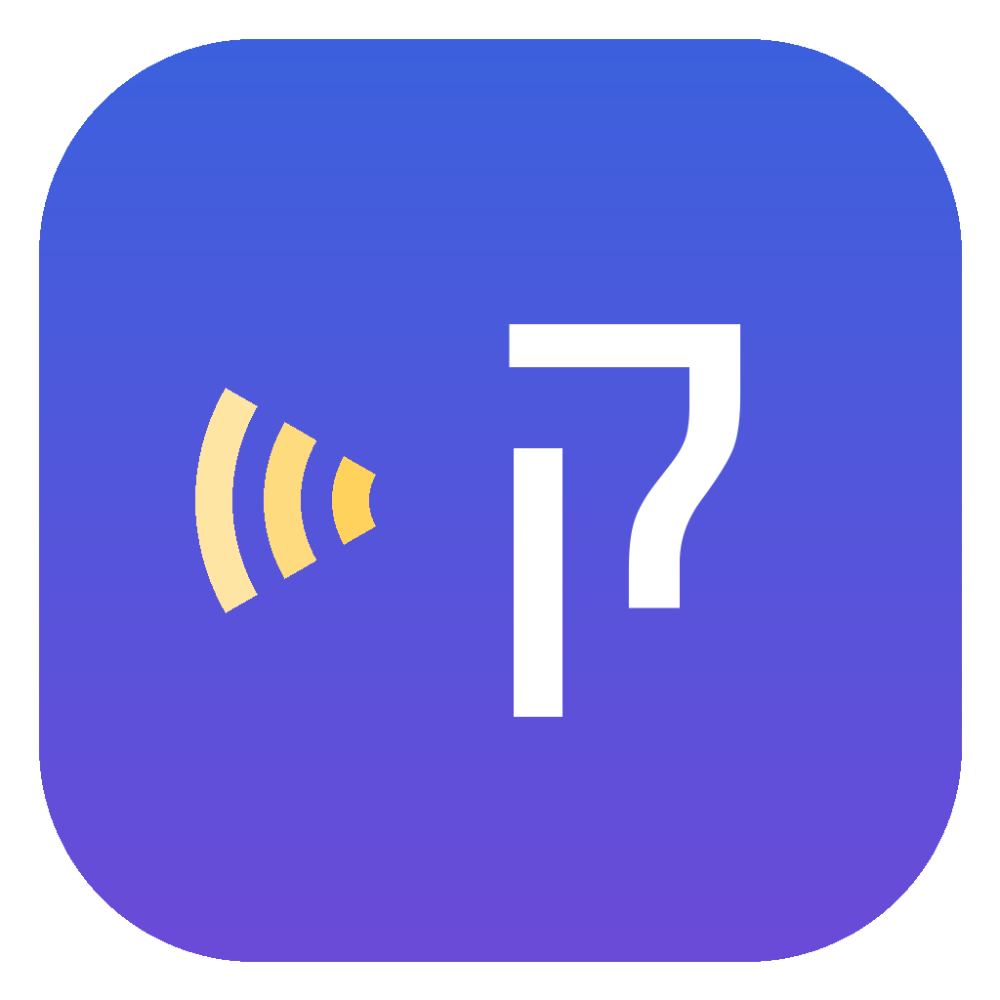
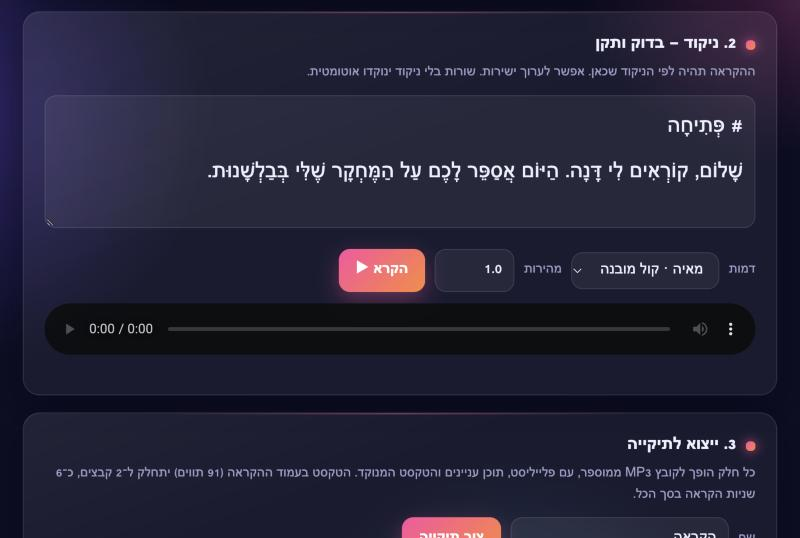
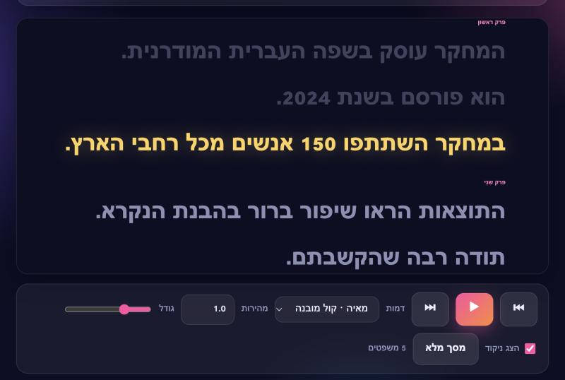
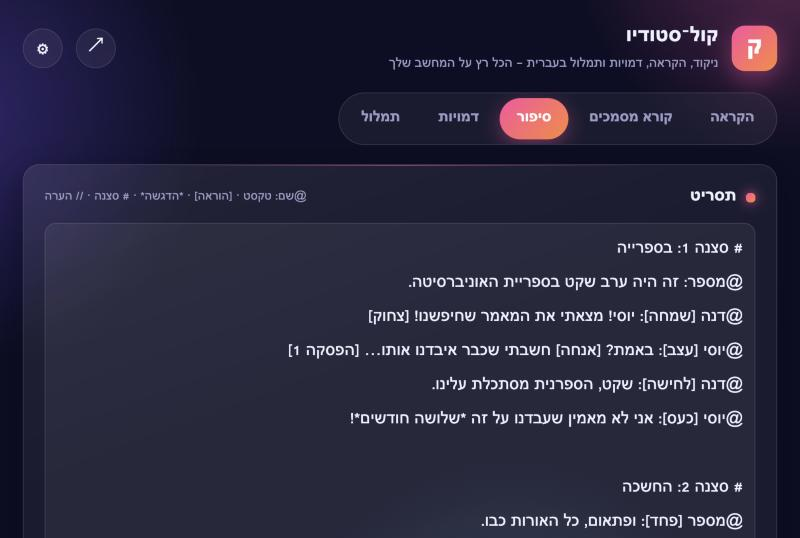
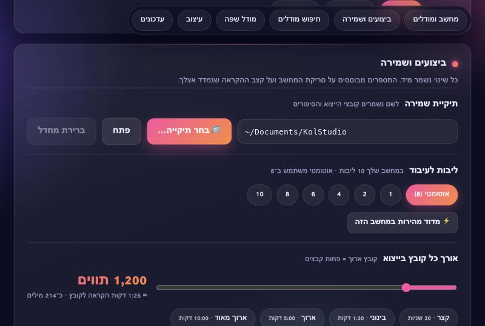

<div dir="rtl">

<p align="center"></p>

<h1 align="center">קול־סטודיו</h1>

<p align="center"><a href="https://github.com/Bnny5985/kol-studio/releases/latest"><b>⬇ הורדה למק ולווינדוס</b></a> · <a href="docs/GUIDE.md"><b>📖 מדריך למשתמש</b></a></p>

תוכנה בעברית ליצירת קול: ניקוד, הקראה, שכפול קול, סיפורים עם כמה דמויות, קורא מסמכים עם טלפרומפטר, ותמלול. **הכל רץ על המחשב שלך**, עם מודלים שנבנו במקור לעברית.

מיועדת ללימודים אקדמיים ולשימוש פרטי. קוד פתוח ברישיון MIT.

<p align="center"> </p>
<p align="center"> </p>

## מה אפשר לעשות

- **הקראה:** טקסט, או קובץ Word, PDF, מצגת או EPUB, עובר ניקוד אוטומטי שאפשר לתקן, ואז הקראה לפי הניקוד שאישרת. מספרים ותאריכים נקראים כמילים.
- **ייצוא לתיקייה:** קובץ MP3 לכל חלק, פלייליסט, תוכן עניינים והטקסט המנוקד.
- **דמויות:** 15 קולות מוכנים, שכפול קול מהקלטה של 8–10 שניות (אפשר לצרף תמלול לבדיקת איכות), וערבוב של שני קולות לקול חדש. אין הגבלה על מספר הדמויות.
- **סיפור:** תסריט עם כמה דמויות והוראות בימוי בלחיצה: רגשות, לחישה, צעקה, הפסקות, נשימה, צחוק ועוד. הייצוא הוא קובץ MP3 וכתוביות SRT לכל סצנה.
- **קורא מסמכים:** טלפרומפטר שבו המשפט שמוקרא מופיע במרכז המסך בצבע אחר.
- **תמלול:** סרטון או הקלטה הופכים לטקסט ולכתוביות, עם מודל ivrit.ai.
- **הגדרות:**
  - סריקת המחשב והמלצה על מודלים שמתאימים לו.
  - חיפוש מודלים לעברית ב־Hugging Face.
  - חיבור ל־LM Studio, ל־Ollama או ל־API חיצוני.
  - עיצוב צבעים.
  - בדיקת עדכונים.

## התקנה

הורידו את קובץ ההתקנה מדף ה־[Releases](https://github.com/Bnny5985/kol-studio/releases):

- **מק (Apple Silicon):** `KolStudio-…-mac-arm64.dmg`. פותחים וגוררים לתיקיית Applications. התוכנה לא חתומה בחתימת מפתח של אפל, ולכן בפתיחה הראשונה צריך ללחוץ עליה **בכפתור ימני ← פתח**.
- **ווינדוס 10/11:** `KolStudio-…-windows-x64-setup.exe`.

בהפעלה הראשונה התוכנה מורידה את המודלים לעברית, כ־2.3GB, ועוד 1.6GB אם בוחרים גם בתמלול. אחר כך היא עובדת בלי אינטרנט.

**איך מתחילים?** הסבר מלא עם צילומי מסך נמצא ב־[מדריך למשתמש](docs/GUIDE.md).

## פיתוח

</div>

```bash
./scripts/setup_dev.sh                 # macOS / Linux, needs uv
.venv/bin/python -m kol_studio.desktop # the app
./scripts/dev_server.sh                # server only, http://127.0.0.1:8765
.venv/bin/pytest -q                    # tests
./packaging/mac/build_mac.sh           # DMG installer
```

<div dir="rtl">

- **ווינדוס:** מריצים את `packaging\windows\build_windows.ps1`. צריך Inno Setup.
- **בנייה אוטומטית:** דחיפה של תג כמו `v0.1.0` לגיטהב בונה את שני קובצי ההתקנה ב־GitHub Actions.

**מבנה:** `kol_studio/` (שרת, ממשק, ניקוד, הקראה, סיפור, הגדרות), `packaging/` (קובצי התקנה), `ARCHITECTURE.md` (תכנון), `TEST_RESULTS.md` (בדיקות המודלים).

## תודות

[BlueTTS](https://github.com/maxmelichov/BlueTTS) ו־RenikudPlus של Max Melichov, ‏[Phonikud](https://github.com/thewh1teagle/phonikud), ‏[Dicta](https://dicta.org.il), ‏[ivrit.ai](https://www.ivrit.ai). פירוט הרישיונות נמצא ב־[THIRD_PARTY.md](THIRD_PARTY.md).

</div>
