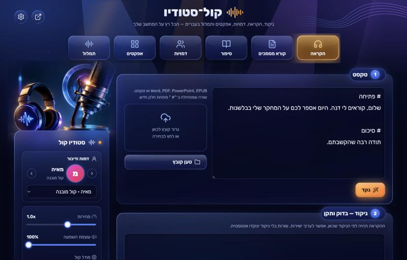
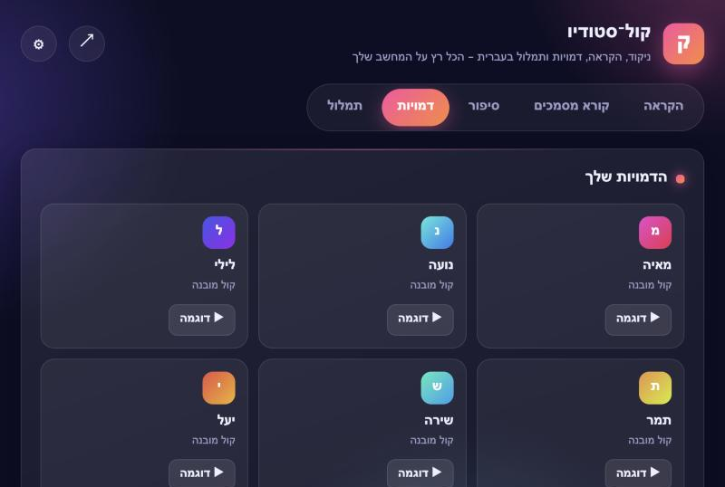
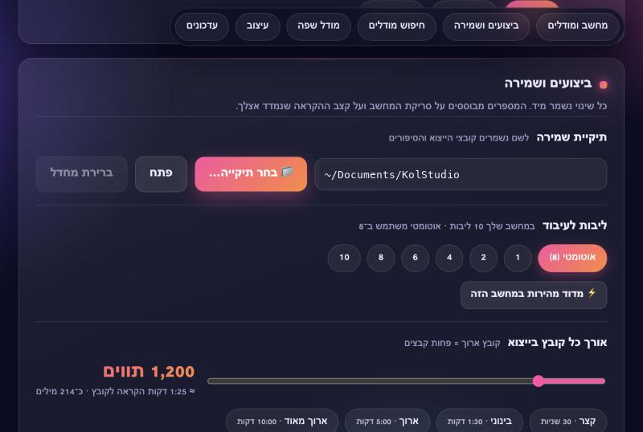

<div dir="rtl">

# מדריך למשתמש — קול־סטודיו

המדריך מסביר צעד אחר צעד איך עובדים עם התוכנה. כל המסכים בעברית, והכל רץ על המחשב שלך.

**תוכן העניינים**
1. [התקנה והפעלה ראשונה](#1-התקנה-והפעלה-ראשונה)
2. [הקראה: טקסט, ניקוד וייצוא](#2-הקראה-טקסט-ניקוד-וייצוא)
3. [קורא מסמכים (טלפרומפטר)](#3-קורא-מסמכים-טלפרומפטר)
4. [סיפור עם כמה דמויות](#4-סיפור-עם-כמה-דמויות)
5. [דמויות: שכפול וערבוב קולות](#5-דמויות-שכפול-וערבוב-קולות)
6. [תמלול סרטונים והקלטות](#6-תמלול-סרטונים-והקלטות)
7. [הגדרות](#7-הגדרות)
8. [חיבור לסוכני AI (MCP)](#8-חיבור-לסוכני-ai-mcp)
9. [שאלות נפוצות](#9-שאלות-נפוצות)

---

## 1. התקנה והפעלה ראשונה

**מק (Apple Silicon: M1 ומעלה)**
1. מורידים את `KolStudio-…-mac-arm64.dmg` מדף ה־[Releases](https://github.com/Bnny5985/kol-studio/releases).
2. פותחים את הקובץ וגוררים את **KolStudio** לתיקיית **Applications**.
3. **בפתיחה הראשונה:** לוחצים על התוכנה **בכפתור ימני ← פתח ← פתח**. צריך לעשות את זה פעם אחת בלבד, כי התוכנה לא חתומה בחתימת מפתח של אפל.

**ווינדוס 10/11**
1. מורידים את `KolStudio-…-windows-x64-setup.exe` ומריצים אותו.
2. אם מופיעה האזהרה "Windows protected your PC", לוחצים **More info ← Run anyway**.

**הורדת המודלים:** בהפעלה הראשונה נפתח מסך "ברוך הבא". לוחצים **הורד והתחל**, והתוכנה מורידה את המודלים לעברית, כ־2.3GB, ועוד 1.6GB אם מסמנים גם תמלול. ההורדה נעשית פעם אחת בלבד, ואחריה התוכנה עובדת בלי אינטרנט.

---

## 2. הקראה: טקסט, ניקוד וייצוא



**שלב 1: טקסט.** מדביקים טקסט, או לוחצים **טען קובץ**. אפשר לטעון Word, ‏PDF, מצגות PowerPoint, ‏EPUB וקובצי טקסט.
- שורה שמתחילה ב־`# ` (סולמית ורווח) היא **כותרת של חלק**. כל חלק הופך לקובץ שמע נפרד בייצוא.
- מספרים, תאריכים ושעות נקראים כמילים. למשל, `10:30` נקרא "עֶשֶׂר וָחֵצִי".


**שלב 2: ניקוד.** לוחצים **נקד ←**, והטקסט המנוקד מופיע בתיבה השנייה. **ההקראה תהיה בדיוק לפי הניקוד שבתיבה הזו.** אם מילה נקראת לא נכון, מתקנים לה את הניקוד ישירות בתיבה. למשל, "סֵפֶר" ו"סַפָּר" נקראות אחרת.

בוחרים **דמות** ו**מהירות**, ולוחצים **הקרא ▶**. אפשר להוריד את התוצאה כקובץ WAV.

**שלב 3: ייצוא לתיקייה.** לוחצים **צור תיקייה**, והתוכנה יוצרת:
- קובץ MP3 ממוספר לכל חלק (`001 - פתיחה.mp3` וכן הלאה).
- `playlist.m3u8`, שמנגן את כל החלקים לפי הסדר.
- קובץ `תוכן עניינים.txt`.
- תיקיית `טקסט` עם הטקסט המנוקד של כל חלק.

מעל הכפתור מוצג לכמה קבצים הטקסט יתחלק וכמה זמן תימשך ההקראה.

---

## 3. קורא מסמכים (טלפרומפטר)


טוענים מסמך או ספר, או לוחצים **קח את הטקסט מעמוד ההקראה**, ואז לוחצים **▶**.

- **המשפט שמוקרא מופיע במרכז המסך בצבע אחר.** משפטים שכבר הוקראו מתעמעמים, והטקסט גולל לבד.
- **רווח** מנגן ועוצר. **חץ שמאלה** עובר למשפט הבא, ו**חץ ימינה** למשפט הקודם. לחיצה על משפט מתחילה ממנו.
- אפשר לבחור **גודל** טקסט, **הצג ניקוד** ו**מסך מלא**, למשל להקרנה בכיתה.
- משפטים הבאים מוכנים מראש, כך שאין הפסקות. את הכמות קובעים בהגדרות.

---

## 4. סיפור עם כמה דמויות


כותבים תסריט. כל שורה מתחילה בשם של דמות:

</div>

```
# סצנה 1: בספרייה
@מספר: זה היה ערב שקט בספריית האוניברסיטה.
@דנה [שמחה]: יוסי! מצאתי את המאמר! [צחוק]
@יוסי [עצב]: באמת? [אנחה] חשבתי שאיבדנו אותו… [הפסקה 1]
@דנה [לחישה]: שקט, הספרנית מסתכלת.
```

<div dir="rtl">

| סימן | משמעות |
|---|---|
| `@שם:` | שורה של דמות |
| `[הוראה]` | הוראת בימוי, למשל `[עצב]`, `[צחוק]`, `[הפסקה 2]` |
| `*מילה*` | הדגשה |
| `# כותרת` | סצנה חדשה, ובייצוא קובץ נפרד לכל סצנה |
| `// הערה` | הערה שלא נקראת |


**הוראות בימוי בלחיצה:** בלוח שבצד לוחצים על הוראה, והיא נכנסת למקום הסמן בצורה הנכונה.
- **רגש:** שמחה, עצב, כעס, פחד, רוגע, התרגשות, הפתעה.
- **אופן דיבור:** לחישה, צעקה, שקט, איטי, מהיר, קול עמוק, קול גבוה.
- **הפסקות:** קצרה, רגילה וארוכה.
- **קולות:** נשימה, אנחה, צחוק, צחקוק, היסוס, מממ, בכי.

רגש או אופן דיבור חלים מהמקום שבו כתבת אותם ועד סוף השורה.

**ליהוק:** כל דמות שמופיעה בתסריט מקבלת אוטומטית בחירת קול. הכפתור **+ הוסף דמות** פותח רשימה של כל הדמויות שלך, עם חיפוש.

**הפקה:** **▶ השמע את השורה של הסמן** מנגן רק שורה אחת. **הפק את הסיפור** יוצר תיקייה עם:
- הסיפור המלא ב־MP3.
- **קובץ MP3 וכתוביות SRT לכל סצנה**, מוכנים לסרטון.
- כתוביות לכל הסיפור, פלייליסט ותסריט.

---

## 5. דמויות: שכפול וערבוב קולות



התוכנה מגיעה עם 15 קולות מוכנים. לכל קול יש כפתור **▶ דוגמה**.


**שכפול קול מהקלטה**
1. כותבים שם לדמות.
2. בוחרים קובץ שמע או וידאו, או לוחצים **הקלט מהמיקרופון**. כדאי להקליט **8–10 שניות של דיבור נקי, בלי מוזיקה**. אפשר גם הקלטה ארוכה יותר, והתוכנה תבחר את הקטע הנקי ביותר.
3. **תמלול (לא חובה):** כותבים מה נאמר בהקלטה, טוענים קובץ, או לוחצים **תמלל אוטומטית**. התוכנה בודקת לפי התמלול את איכות ההקלטה, ומציגה אחוז התאמה.
4. מסמנים **זה הקול שלי, או שיש לי הסכמה של בעל הקול**, ולוחצים **צור דמות**.

**ערבוב קולות:** בוחרים שני קולות ויחס ביניהם, והתוכנה יוצרת קול חדש שלא שייך לאף אדם אמיתי. אין הגבלה על מספר הדמויות.

> חשוב: משכפלים קול של אדם אחר רק בהסכמתו.

---

## 6. תמלול סרטונים והקלטות

בוחרים קובץ וידאו או שמע ולוחצים **תמלל**. מקבלים טקסט, אפשר להוריד **כתוביות SRT**, ובלחיצה על **העבר להקראה** הטקסט עובר לעמוד ההקראה. התמלול נעשה עם מודל ivrit.ai, שנבנה במיוחד לעברית.

---

## 7. הגדרות

לוחצים על **⚙** בפינה העליונה. שינויים נשמרים מיד.


**מחשב ומודלים:** התוכנה סורקת את המחשב (מעבד, זיכרון, מעבד גרפי, מקום פנוי) ומסמנת **"מומלץ למחשב שלך"** ליד המודלים שמתאימים. מודלים לא מותקנים אפשר להוריד מכאן.



**ביצועים ושמירה**
- **תיקיית שמירה:** **📁 בחר תיקייה…** פותח את חלון בחירת התיקיות של המחשב.
- **ליבות לעיבוד:** האפשרויות נלקחות מסריקת המחשב. **⚡ מדוד מהירות** בודק איזה מספר ליבות הכי מהיר במחשב שלך, ומציע להשתמש בו.
- **אורך כל קובץ בייצוא:** המספרים מתעדכנים בזמן הגרירה: כמה תווים, כמה דקות הקראה וכמה מילים. הזמנים מבוססים על קצב ההקראה שנמדד במחשב שלך.
- **משפטים מוכנים מראש בקורא:** בין 1 ל־6.

**חיפוש מודלים:** מחפש ב־Hugging Face מודלים לעברית ומסמן מה מתאים למחשב.

**מודל שפה (API):** חיבור ל־LM Studio או ל־Ollama שרצים על המחשב (יש כפתור **זהה שרתים מקומיים**), או לשירות חיצוני כמו OpenAI, ‏Claude, ‏Gemini או OpenRouter. המפתח נשמר רק במחשב שלך.


**עיצוב:** מצב כהה או בהיר, שילובי צבעים מוכנים או צבעים משלך, גופן, גודל טקסט, עיגול פינות, וצבעי הטלפרומפטר.

**עדכונים:** **חפש עדכון** בודק אם יש גרסה חדשה בגיטהב. אפשר לבקש בדיקה אוטומטית בכל פתיחה.

---

## 8. חיבור לסוכני AI (MCP)

סוכני AI, כמו Antigravity, ‏Claude Desktop או Cursor, יכולים להפעיל את קול־סטודיו דרך פרוטוקול MCP. הם יכולים לנקד, להקריא, לייצא מסמכים, להפיק סיפורים, לתמלל וליצור דמויות. גם כשסוכן מפעיל את התוכנה, הכל רץ על המחשב שלך.

**חיבור ל־Antigravity בלחיצה:**
1. פותחים **⚙ הגדרות ← סוכני AI** ולוחצים **הוסף ל־Antigravity**. התוכנה מוסיפה את עצמה לקובץ `~/.gemini/config/mcp_config.json` ושומרת גיבוי של הקובץ הקודם.
2. ב־Antigravity פותחים **MCP Servers** ולוחצים **Refresh**, או מפעילים אותו מחדש.
3. לוחצים **העתק פרומפט לסוכן** ומדביקים אותו בשיחה עם הסוכן.

**חיבור לתוכנה אחרת:** **העתק הגדרות MCP** מעתיק את ההגדרות בפורמט JSON. מדביקים אותן בהגדרות ה־MCP של התוכנה.

אם קול־סטודיו סגורה כשהסוכן פונה אליה, היא נפתחת לבד.

**הכלים שהסוכן מקבל:**

| כלי | מה הוא עושה |
|---|---|
| `kol_status` | בודק שהחיבור עובד |
| `list_characters` | רשימת הדמויות |
| `add_nikud` | ניקוד טקסט |
| `speak` | הקראה לקובץ WAV |
| `extract_document` | קריאת טקסט מקובץ Word, ‏PDF, מצגת או EPUB |
| `export_audio_folder` | ייצוא לתיקיית MP3 עם פלייליסט |
| `story_directions` | פורמט התסריט והוראות הבימוי |
| `render_story` | הפקת סיפור עם כמה דמויות |
| `job_status` | מצב של משימה ארוכה |
| `transcribe` | תמלול לטקסט ולכתוביות |
| `clone_voice` | שכפול קול, רק בהסכמת בעל הקול |
| `mix_voices` | ערבוב שני קולות לדמות חדשה |
| `open_folder` | פתיחת תיקיית התוצאות |

---

## 9. שאלות נפוצות

**מילה נקראת לא נכון.** מתקנים את הניקוד שלה בתיבה השנייה בעמוד ההקראה. ההקראה תמיד הולכת לפי הניקוד.

**המיקרופון לא עובד בחלון התוכנה.** לוחצים על **↗** בפינה העליונה. הכפתור פותח את התוכנה בדפדפן, ושם המיקרופון עובד.

**איפה הקבצים שיצרתי?** בתיקיית השמירה שבהגדרות. ברירת המחדל היא `Documents/KolStudio`. אחרי כל ייצוא מופיע כפתור **פתח את התיקייה**.

**איפה נשמרים הקולות וההגדרות?**
- במק: `~/Library/Application Support/KolStudio`.
- בווינדוס: `%APPDATA%\KolStudio`.

גם כשמסירים את התוכנה, הקבצים האלה לא נמחקים.

**PDF סרוק לא נטען.** PDF שנסרק כתמונה לא מכיל טקסט, ולכן צריך קודם להעביר אותו OCR.

**האם הכל באמת נשאר במחשב?** כן. הקראה, ניקוד, שכפול ותמלול רצים מקומית. אינטרנט צריך רק להורדת המודלים בפעם הראשונה, לחיפוש מודלים, לבדיקת עדכונים, ולשירות API חיצוני אם בחרת בו.

</div>
