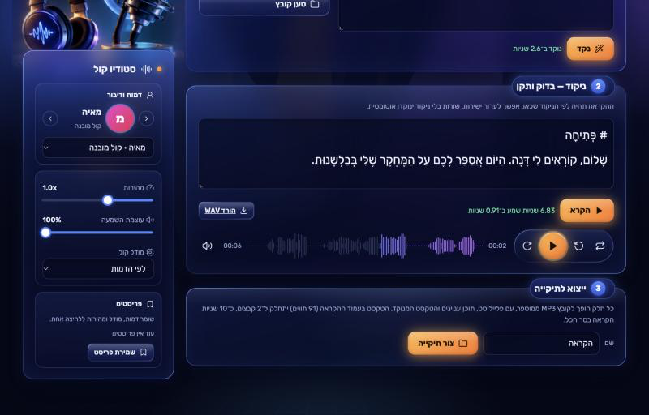
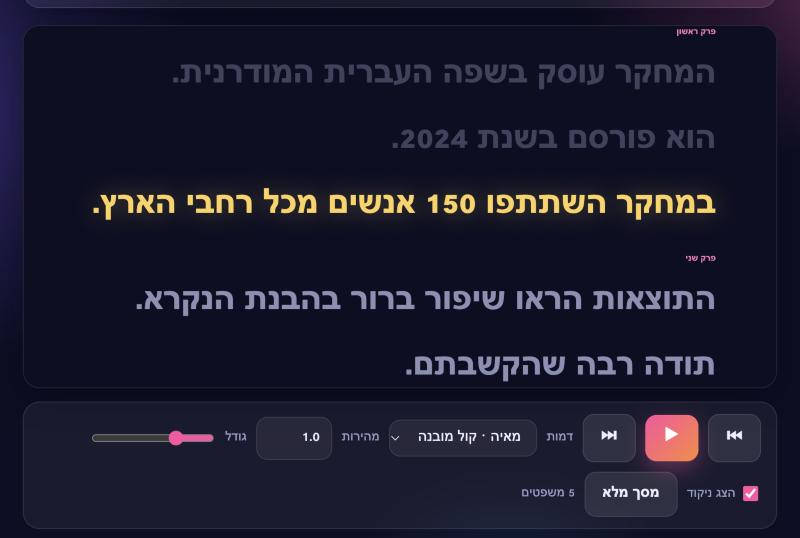
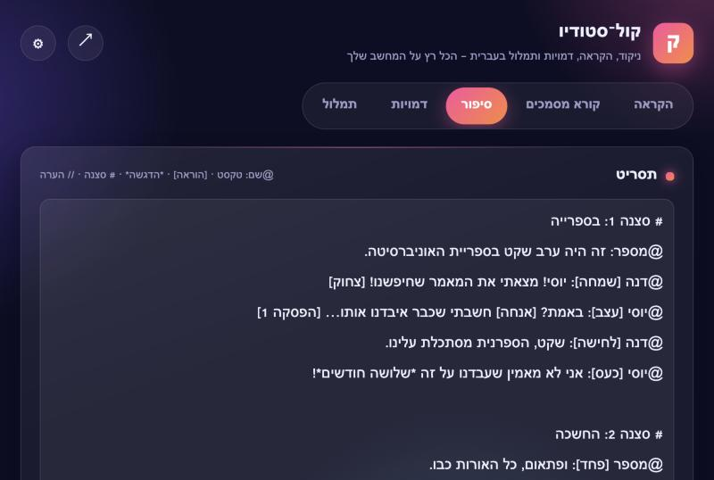
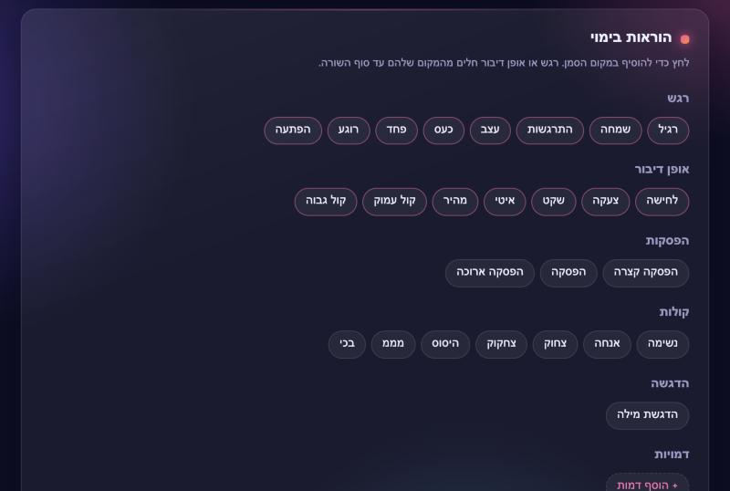
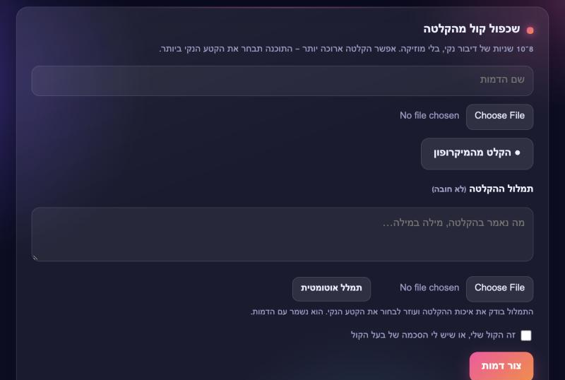
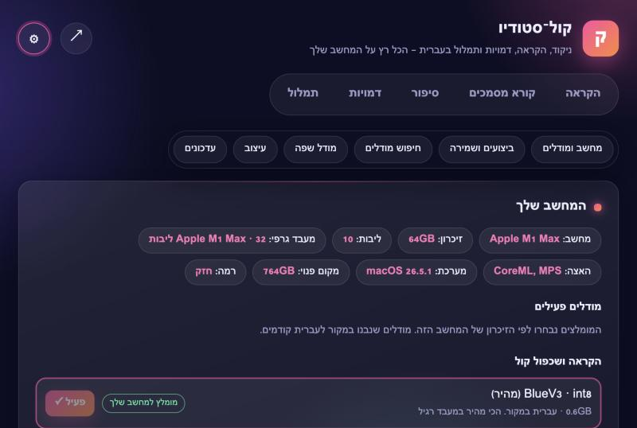
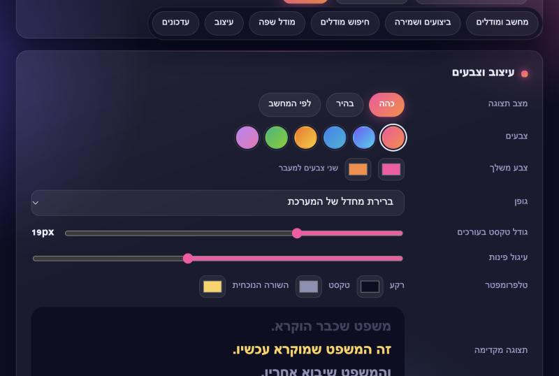
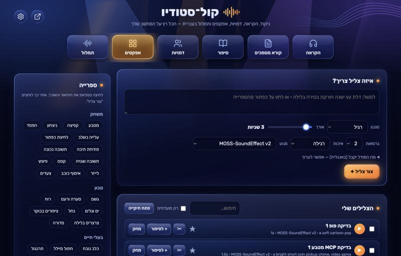

<div dir="rtl">

# מדריך למשתמש — קול־סטודיו

המדריך מסביר צעד אחר צעד איך עובדים עם התוכנה. כל המסכים בעברית, והכל רץ על המחשב שלך.

**תוכן העניינים**
1. [התקנה והפעלה ראשונה](#1-התקנה-והפעלה-ראשונה)
2. [הקראה: טקסט, ניקוד וייצוא](#2-הקראה-טקסט-ניקוד-וייצוא)
3. [קורא מסמכים (טלפרומפטר)](#3-קורא-מסמכים-טלפרומפטר)
4. [סיפור עם כמה דמויות](#4-סיפור-עם-כמה-דמויות)
5. [דמויות: שכפול וערבוב קולות](#5-דמויות-שכפול-וערבוב-קולות)
6. [תמלול סרטונים והקלטות](#6-תמלול-סרטונים-והקלטות)
7. [הגדרות](#7-הגדרות)
8. [חיבור לסוכני AI (MCP)](#8-חיבור-לסוכני-ai-mcp)
9. [מנוע Fish S2-Pro: רגשות טבעיים](#9-מנוע-fish-s2-pro-רגשות-טבעיים)
10. [אפקטים קוליים](#10-אפקטים-קוליים)
11. [שאלות נפוצות](#11-שאלות-נפוצות)

---

## 1. התקנה והפעלה ראשונה

**מק (Apple Silicon: M1 ומעלה)**
1. מורידים את `KolStudio-…-mac-arm64.dmg` מדף ה־[Releases](https://github.com/Bnny5985/kol-studio/releases).
2. פותחים את הקובץ וגוררים את **KolStudio** לתיקיית **Applications**.
3. **בפתיחה הראשונה** מופיעה הודעת אבטחה, כי התוכנה לא חתומה בחתימה בתשלום של אפל. מאשרים אותה פעם אחת בלבד:
   - לוחצים פעמיים על KolStudio. כשמופיעה ההודעה, לוחצים **סיום** (Done).
   - פותחים **הגדרות המערכת ← פרטיות ואבטחה**, וגוללים למטה עד השורה "KolStudio נחסם".
   - לוחצים **לפתוח בכל זאת** (Open Anyway), מקלידים את סיסמת המחשב, ולוחצים **פתח**.
   - בגרסאות ישנות של macOS (עד 14) אפשר גם ללחוץ על התוכנה **בכפתור ימני ← פתח ← פתח**.

**אם מופיעה ההודעה "KolStudio פגום ולא ניתן לפתוח אותו":** התוכנה לא פגומה. זו הגנה של macOS על קבצים שהורדו מהאינטרנט. פותחים את **Terminal**, מדביקים את השורה הבאה, ולוחצים Enter:

```bash
xattr -dr com.apple.quarantine /Applications/KolStudio.app
```

אחר כך פותחים את התוכנה כרגיל.

> התוכנה מיועדת למק עם שבב Apple (M1 ומעלה). במק ישן עם מעבד Intel היא לא תיפתח. בודקים בתפריט  ← **אודות מק זה**: אם כתוב "שבב Apple M…", הכל בסדר.

**ווינדוס 10/11**
1. מורידים את `KolStudio-…-windows-x64-setup.exe` ומריצים אותו.
2. אם מופיעה האזהרה "Windows protected your PC", לוחצים **More info ← Run anyway**.

**הורדת המודלים:** בהפעלה הראשונה נפתח מסך "ברוך הבא". לוחצים **הורד והתחל**, והתוכנה מורידה את המודלים לעברית, כ־2.3GB, ועוד 1.6GB אם מסמנים גם תמלול. ההורדה נעשית פעם אחת בלבד, ואחריה התוכנה עובדת בלי אינטרנט.

---

## 2. הקראה: טקסט, ניקוד וייצוא


**שלב 1: טקסט.** מדביקים טקסט, גוררים קובץ לתיבה המקווקוות, או לוחצים **טען קובץ**. אפשר לטעון Word, ‏PDF, מצגות PowerPoint, ‏EPUB וקובצי טקסט.
- שורה שמתחילה ב־`# ` (סולמית ורווח) היא **כותרת של חלק**. כל חלק הופך לקובץ שמע נפרד בייצוא.
- מספרים, תאריכים ושעות נקראים כמילים. למשל, `10:30` נקרא "עֶשֶׂר וָחֵצִי".



**שלב 2: ניקוד.** לוחצים **נקד**, והטקסט המנוקד מופיע בתיבה השנייה. **ההקראה תהיה בדיוק לפי הניקוד שבתיבה הזו.** אם מילה נקראת לא נכון, מתקנים לה את הניקוד ישירות בתיבה. למשל, "סֵפֶר" ו"סַפָּר" נקראות אחרת.

בלוח **סטודיו קול** שבצד בוחרים דמות (בחצים או ברשימה), מהירות, עוצמת השמעה ומודל קול, ולוחצים **הקרא**. הנגן מציג את צורת הגל: אפשר ללחוץ על הגל כדי לקפוץ, לחזור או להתקדם 5 שניות, ולהפעיל השמעה חוזרת. אפשר להוריד את התוצאה כקובץ WAV.

**פריסטים:** ‏**שמירת פריסט** שומר את הדמות, המודל והמהירות, ולחיצה על הפריסט מחזירה אותם.

**שלב 3: ייצוא לתיקייה.** לוחצים **צור תיקייה**, והתוכנה יוצרת:
- קובץ MP3 ממוספר לכל חלק (`001 - פתיחה.mp3` וכן הלאה).
- `playlist.m3u8`, שמנגן את כל החלקים לפי הסדר.
- קובץ `תוכן עניינים.txt`.
- תיקיית `טקסט` עם הטקסט המנוקד של כל חלק.

מעל הכפתור מוצג לכמה קבצים הטקסט יתחלק וכמה זמן תימשך ההקראה.

---

## 3. קורא מסמכים (טלפרומפטר)



טוענים מסמך או ספר, או לוחצים **קח את הטקסט מעמוד ההקראה**, ואז לוחצים **▶**.

- **המשפט שמוקרא מופיע במרכז המסך בצבע אחר.** משפטים שכבר הוקראו מתעמעמים, והטקסט גולל לבד.
- **רווח** מנגן ועוצר. **חץ שמאלה** עובר למשפט הבא, ו**חץ ימינה** למשפט הקודם. לחיצה על משפט מתחילה ממנו.
- אפשר לבחור **גודל** טקסט, **הצג ניקוד** ו**מסך מלא**, למשל להקרנה בכיתה.
- משפטים הבאים מוכנים מראש, כך שאין הפסקות. את הכמות קובעים בהגדרות.

---

## 4. סיפור עם כמה דמויות



כותבים תסריט. כל שורה מתחילה בשם של דמות:

</div>

```
# סצנה 1: בספרייה
@מספר: זה היה ערב שקט בספריית האוניברסיטה.
@דנה [שמחה]: יוסי! מצאתי את המאמר! [צחוק]
@יוסי [עצב]: באמת? [אנחה] חשבתי שאיבדנו אותו… [הפסקה 1]
@דנה [לחישה]: שקט, הספרנית מסתכלת.
```

<div dir="rtl">

| סימן | משמעות |
|---|---|
| `@שם:` | שורה של דמות |
| `[הוראה]` | הוראת בימוי, למשל `[עצב]`, `[צחוק]`, `[הפסקה 2]` |
| `*מילה*` | הדגשה |
| `# כותרת` | סצנה חדשה, ובייצוא קובץ נפרד לכל סצנה |
| `// הערה` | הערה שלא נקראת |



**הוראות בימוי בלחיצה:** בלוח שבצד לוחצים על הוראה, והיא נכנסת למקום הסמן בצורה הנכונה.
- **רגש:** שמחה, עצב, כעס, פחד, רוגע, התרגשות, הפתעה.
- **אופן דיבור:** לחישה, צעקה, שקט, איטי, מהיר, קול עמוק, קול גבוה.
- **הפסקות:** קצרה, רגילה וארוכה.
- **קולות:** נשימה, אנחה, צחוק, צחקוק, היסוס, מממ, בכי.

רגש או אופן דיבור חלים מהמקום שבו כתבת אותם ועד סוף השורה.

**ליהוק:** כל דמות שמופיעה בתסריט מקבלת אוטומטית בחירת קול. הכפתור **+ הוסף דמות** פותח רשימה של כל הדמויות שלך, עם חיפוש.

**הפקה:** **▶ השמע את השורה של הסמן** מנגן רק שורה אחת. **הפק את הסיפור** יוצר תיקייה עם:
- הסיפור המלא ב־MP3.
- **קובץ MP3 וכתוביות SRT לכל סצנה**, מוכנים לסרטון.
- כתוביות לכל הסיפור, פלייליסט ותסריט.

---

## 5. דמויות: שכפול וערבוב קולות


התוכנה מגיעה עם 15 קולות מוכנים. לכל קול יש כפתור **▶ דוגמה**.



**שכפול קול מהקלטה**
1. כותבים שם לדמות.
2. בוחרים קובץ שמע או וידאו, או לוחצים **הקלט מהמיקרופון**. כדאי להקליט **8–10 שניות של דיבור נקי, בלי מוזיקה**. אפשר גם הקלטה ארוכה יותר, והתוכנה תבחר את הקטע הנקי ביותר.
3. **תמלול (לא חובה):** כותבים מה נאמר בהקלטה, טוענים קובץ, או לוחצים **תמלל אוטומטית**. התוכנה בודקת לפי התמלול את איכות ההקלטה, ומציגה אחוז התאמה.
4. מסמנים **זה הקול שלי, או שיש לי הסכמה של בעל הקול**, ולוחצים **צור דמות**.

**ערבוב קולות:** בוחרים שני קולות ויחס ביניהם, והתוכנה יוצרת קול חדש שלא שייך לאף אדם אמיתי. אין הגבלה על מספר הדמויות.

**מודל קול לכל דמות:** בכרטיס של כל דמות יש בחירה **מודל קול**: ‏BlueV3 (מהיר), ‏QwenTTS-he (הכי ברור) או Fish S2-Pro (רגשות). את שני האחרונים מתקינים בהגדרות. בעמוד ההקראה ובעמוד הסיפור, כשהבחירה היא **לפי הדמות**, כל דמות מדברת במודל שלה. כך אפשר, למשל, שהמספר ידבר ב־BlueV3 והדמויות הרגשיות ב־Fish.

> חשוב: משכפלים קול של אדם אחר רק בהסכמתו.

---

## 6. תמלול סרטונים והקלטות

בוחרים קובץ וידאו או שמע ולוחצים **תמלל**. מקבלים טקסט, אפשר להוריד **כתוביות SRT**, ובלחיצה על **העבר להקראה** הטקסט עובר לעמוד ההקראה. התמלול נעשה עם מודל ivrit.ai, שנבנה במיוחד לעברית.

---

## 7. הגדרות

לוחצים על **⚙** בפינה העליונה. שינויים נשמרים מיד.



**מחשב ומודלים:** התוכנה סורקת את המחשב (מעבד, זיכרון, מעבד גרפי, מקום פנוי) ומסמנת **"מומלץ למחשב שלך"** ליד המודלים שמתאימים. מודלים לא מותקנים אפשר להוריד מכאן.


**ביצועים ושמירה**
- **תיקיית שמירה:** **📁 בחר תיקייה…** פותח את חלון בחירת התיקיות של המחשב.
- **ליבות לעיבוד:** האפשרויות נלקחות מסריקת המחשב. **⚡ מדוד מהירות** בודק איזה מספר ליבות הכי מהיר במחשב שלך, ומציע להשתמש בו.
- **אורך כל קובץ בייצוא:** המספרים מתעדכנים בזמן הגרירה: כמה תווים, כמה דקות הקראה וכמה מילים. הזמנים מבוססים על קצב ההקראה שנמדד במחשב שלך.
- **משפטים מוכנים מראש בקורא:** בין 1 ל־6.

**חיפוש מודלים:** מחפש ב־Hugging Face מודלים לעברית ומסמן מה מתאים למחשב.

**מודל שפה (API):** חיבור ל־LM Studio או ל־Ollama שרצים על המחשב (יש כפתור **זהה שרתים מקומיים**), או לשירות חיצוני כמו OpenAI, ‏Claude, ‏Gemini או OpenRouter. המפתח נשמר רק במחשב שלך.



**עיצוב:** מצב כהה או בהיר, שילובי צבעים מוכנים או צבעים משלך, גופן, גודל טקסט, עיגול פינות, וצבעי הטלפרומפטר.

**עדכונים:** **חפש עדכון** בודק אם יש גרסה חדשה בגיטהב. אפשר לבקש בדיקה אוטומטית בכל פתיחה.

---

## 8. חיבור לסוכני AI (MCP)

סוכני AI, כמו Antigravity, ‏Claude Desktop או Cursor, יכולים להפעיל את קול־סטודיו דרך פרוטוקול MCP. הם יכולים לנקד, להקריא, לייצא מסמכים, להפיק סיפורים, לתמלל וליצור דמויות. גם כשסוכן מפעיל את התוכנה, הכל רץ על המחשב שלך.

**חיבור ל־Antigravity בלחיצה:**
1. פותחים **⚙ הגדרות ← סוכני AI** ולוחצים **הוסף ל־Antigravity**. התוכנה מוסיפה את עצמה לקובץ `~/.gemini/config/mcp_config.json` ושומרת גיבוי של הקובץ הקודם.
2. ב־Antigravity פותחים **MCP Servers** ולוחצים **Refresh**, או מפעילים אותו מחדש.
3. לוחצים **העתק פרומפט לסוכן** ומדביקים אותו בשיחה עם הסוכן.

**חיבור לתוכנה אחרת:** **העתק הגדרות MCP** מעתיק את ההגדרות בפורמט JSON. מדביקים אותן בהגדרות ה־MCP של התוכנה.

אם קול־סטודיו סגורה כשהסוכן פונה אליה, היא נפתחת לבד.

**הכלים שהסוכן מקבל:**

| כלי | מה הוא עושה |
|---|---|
| `kol_status` | בודק שהחיבור עובד |
| `list_characters` | רשימת הדמויות |
| `add_nikud` | ניקוד טקסט |
| `speak` | הקראה לקובץ WAV |
| `extract_document` | קריאת טקסט מקובץ Word, ‏PDF, מצגת או EPUB |
| `export_audio_folder` | ייצוא לתיקיית MP3 עם פלייליסט |
| `story_directions` | פורמט התסריט והוראות הבימוי |
| `render_story` | הפקת סיפור עם כמה דמויות |
| `job_status` | מצב של משימה ארוכה |
| `transcribe` | תמלול לטקסט ולכתוביות |
| `clone_voice` | שכפול קול, רק בהסכמת בעל הקול |
| `mix_voices` | ערבוב שני קולות לדמות חדשה |
| `sound_effect` | יצירת אפקט קולי מתיאור (גשם, צעדים, מטבע…) |
| `sfx_library` | ספריית האפקטים המוכנה והמנועים המותקנים |
| `list_sounds` | הצלילים שכבר נוצרו |
| `export_sounds` | ייצוא צלילים לתיקייה (למשל של משחק) כ־OGG/WAV/MP3 |
| `open_folder` | פתיחת תיקיית התוצאות |

---

## 9. מנוע Fish S2-Pro: רגשות טבעיים

מנוע הקראה נוסף, שאפשר להתקין אם רוצים. הוא מבוסס על [Fish Audio S2-Pro](https://huggingface.co/fishaudio/s2-pro), עם התוספת העברית של [notmax123](https://huggingface.co/notmax123/Fish-Audio-S2-Pro-He).
- **רגשות וקולות שהמודל מייצר בעצמו:** כותבים בתוך הטקסט תגיות באנגלית בסוגריים, למשל `[laughing]`, `[whisper]`, `[sad]`, `[angry]`, `[shouting]`, `[sigh]` או `[excited]`. המודל מכיר יותר מ־15,000 תגיות, ואפשר גם לכתוב תיאור חופשי.
- **בסיפורים:** הוראות הבימוי בעברית (שמחה, לחישה, צחוק ועוד) הופכות אוטומטית לתגיות של Fish.
- **אותו קול לכל דמות:** לקולות מוכנים ולקולות מעורבבים התוכנה מכינה דוגמת קול קצרה עם BlueV3. לקולות משוכפלים היא משתמשת בהקלטה המקורית ובתמלול שלה.

**התקנה:** פותחים **⚙ הגדרות ← מחשב ומודלים ← Fish-Audio S2 Pro ← התקן**. ההתקנה תופסת כ־13GB. ההתקנה מוצגת רק אחרי שמאשרים את הרישיון. אם היא נקטעת, לוחצים שוב והיא ממשיכה מאיפה שעצרה.

**שימוש:** בעמוד ההקראה ובעמוד הסיפור בוחרים **מנוע ← Fish S2-Pro**. בהקראה הראשונה המודל נטען, וזה לוקח כדקה וחצי.

**מהירות:** במק עם M1 Max, ‏Fish איטי בערך פי 5 מזמן אמת. שורה של 4 שניות לוקחת כ־20–25 שניות. ‏BlueV3 מהיר פי 13 מזמן אמת. לכן Fish מתאים לשורות דיבור מוקפדות, למשל למשחק או לסרטון, ופחות לקריאת ספרים.

> ⚠️ **רישיון:** ‏Fish Audio S2-Pro מופץ ברישיון **Fish Audio Research License**, ומותר בו **מחקר ושימוש לא מסחרי בלבד**. אם הפרויקט שלך מוכר משהו או מכניס כסף, צריך רישיון בתשלום מ־Fish Audio. מי שמפיץ תוכן שנוצר בו צריך לציין: **"Built with Fish Audio"**. ‏BlueV3, מנוע ברירת המחדל, ברישיון MIT ומותר גם לשימוש מסחרי.

---

### מנוע QwenTTS-he: ההגייה הכי ברורה

מנוע הקראה נוסף, שאפשר להתקין: [QwenTTS-he](https://huggingface.co/notmax123/QwenTTS-he-1.7B) של notmax123, שבנוי על Qwen3-TTS. בבדיקות התמלול שלנו כל המשפטים יצאו מדויקים, כולל מילים כמו "סָפַר" ו"סֵפֶר". הוא משכפל קול מהקלטה, כמו BlueV3, אבל אין בו רגשות.
- **התקנה:** ‏**⚙ הגדרות ← מחשב ומודלים ← QwenTTS-he ← התקן** (כ־4.5GB). הרישיון Apache-2.0, ומותר לכל שימוש.
- **מהירות:** במק עם M1 Max הוא איטי בערך פי 5 מזמן אמת. ההקראה הראשונה אחרי פתיחת התוכנה לוקחת יותר זמן.
- **שימוש:** בוחרים **מודל קול ← QwenTTS-he** בעמוד ההקראה או הסיפור, או קובעים אותו לדמות מסוימת בכרטיס שלה.

---

## 10. אפקטים קוליים



עמוד **אפקטים** מייצר צלילים שאינם דיבור: צעדים, גשם, מטבע במשחק, דלת חורקת, פיצוץ, מחיאות כפיים ועוד. הכל רץ על המחשב.

**שני מנועים (אפשר להתקין את שניהם):**

| מנוע | מהירות | איכות | רישיון |
|---|---|---|---|
| **Stable Audio 3 · SFX** ‏(Stability AI) | מהיר: כמה שניות לצליל | סטריאו 44.1kHz, עד 47 שניות | Stability AI Community: חינם למחקר, ללימודים ולשימוש אישי, ולעסקים עם הכנסה של פחות ממיליון דולר בשנה. דורש חשבון Hugging Face |
| **MOSS-SoundEffect v2** ‏(OpenMOSS) | איטי: כדקה לצליל קצר ב־Mac (M1 Max) | 48kHz, עד 30 שניות. טוב לרעשי רקע ואווירה | Apache-2.0: פתוח לגמרי, גם מסחרי |

**התקנה:** בעמוד האפקטים (או ב־**⚙ הגדרות ← מחשב ומודלים ← אפקטים קוליים**) לוחצים **התקן**. ל־Stable Audio צריך קודם:
1. להיכנס ל[דף המודל](https://huggingface.co/stabilityai/stable-audio-3-small-sfx) ב־Hugging Face וללחוץ על אישור התנאים.
2. ליצור [אסימון גישה מסוג Read](https://huggingface.co/settings/tokens) ולהדביק אותו בחלון ההתקנה. האסימון נשמר רק במחשב שלך.

**יצירת צליל:**
1. כותבים בעברית מה רוצים לשמוע, למשל "דלת עץ ישנה חורקת בטירה בלילה", או לוחצים על כפתור מה**ספרייה** (משחק, טבע, בעלי חיים, בית ועיר, אנשים, מתח ופחד, מעברים).
2. בוחרים **סגנון** (מציאותי, קולנועי, מצויר, משחק 8-ביט, רחוק, קרוב), **אורך** ומספר **גרסאות**.
3. לוחצים **צור צליל ✦**. מקבלים כמה גרסאות, ובוחרים את הטובה עם **★ למועדפים**.

המודלים מבינים רק אנגלית, ולכן התוכנה מתרגמת את התיאור. אם הגדרת מודל שפה (LM Studio, Ollama או API), הוא מתרגם. אחרת התוכנה משתמשת במילון מובנה. את הנוסח האנגלי אפשר לראות ולתקן תחת **מה המודל יקבל**.

**עריכה (✂):** חיתוך ההתחלה והסוף, עוצמה, הופעה ודעיכה הדרגתית, ו**לולאה חלקה** לרעשי רקע במשחק. העותק הערוך נשמר ליד המקור.

**ייצוא למשחק או לסרטון:** מסמנים צלילים ב"הצלילים שלי", בוחרים פורמט (WAV, ‏OGG למשחקים, MP3), קצב דגימה ותיקיית יעד, ולוחצים **ייצא**. האפשרות **שמות קבצים באנגלית** נותנת שמות שמנועי משחק אוהבים, למשל `a_bright_short_coin_pickup_chime_1.ogg`.

**בתוך סיפור:**
- `[אפקט: מטבע]` משמיע צליל בדיוק באותו מקום בשורה.
- `[רקע: גשם]` מנגן צליל רקע שקט בלולאה מאותו מקום ועד סוף הסצנה. `[רקע: ללא]` עוצר אותו.

השם הוא שם של צליל שלך, או שם של כפתור מהספרייה. אם עוד אין צליל כזה, התוכנה יוצרת אותו פעם אחת ושומרת.

הצלילים נשמרים בתיקיית התוצאות, בתת־התיקייה `אפקטים קוליים`.

---

## 11. שאלות נפוצות

**מילה נקראת לא נכון.** מתקנים את הניקוד שלה בתיבה השנייה בעמוד ההקראה. ההקראה תמיד הולכת לפי הניקוד.

**המיקרופון לא עובד בחלון התוכנה.** לוחצים על **↗** בפינה העליונה. הכפתור פותח את התוכנה בדפדפן, ושם המיקרופון עובד.

**איפה הקבצים שיצרתי?** בתיקיית השמירה שבהגדרות. ברירת המחדל היא `Documents/KolStudio`. אחרי כל ייצוא מופיע כפתור **פתח את התיקייה**.

**איפה נשמרים הקולות וההגדרות?**
- במק: `~/Library/Application Support/KolStudio`.
- בווינדוס: `%APPDATA%\KolStudio`.

גם כשמסירים את התוכנה, הקבצים האלה לא נמחקים.

**PDF סרוק לא נטען.** PDF שנסרק כתמונה לא מכיל טקסט, ולכן צריך קודם להעביר אותו OCR.

**האם הכל באמת נשאר במחשב?** כן. הקראה, ניקוד, שכפול ותמלול רצים מקומית. אינטרנט צריך רק להורדת המודלים בפעם הראשונה, לחיפוש מודלים, לבדיקת עדכונים, ולשירות API חיצוני אם בחרת בו.

</div>
